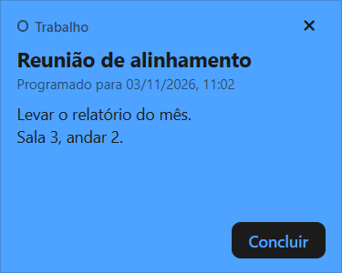
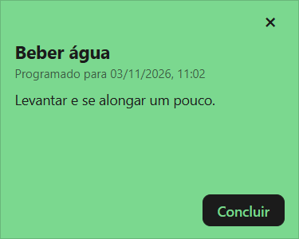
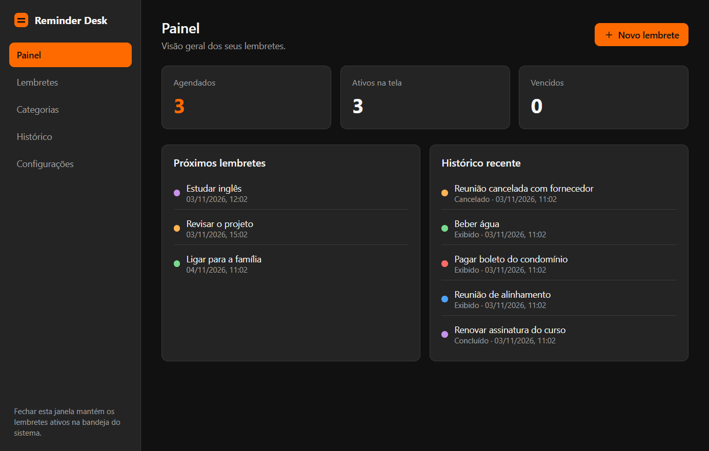
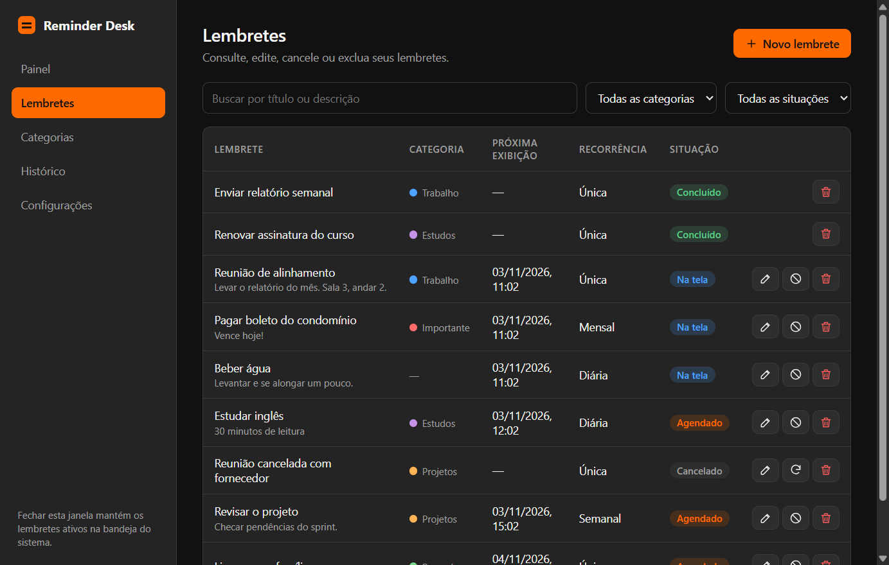
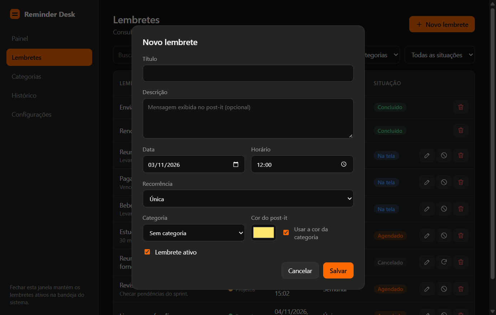
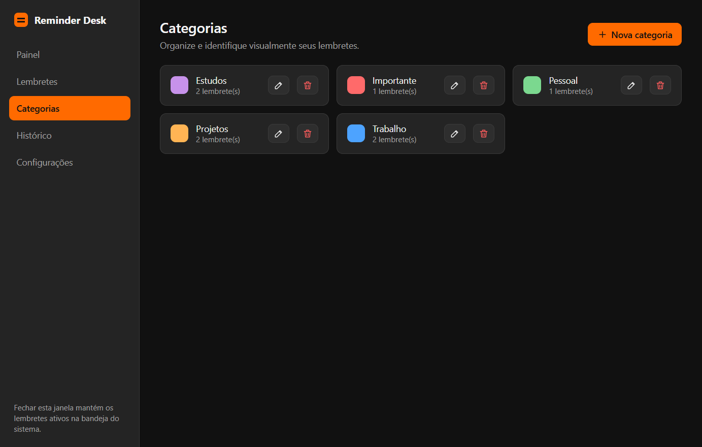
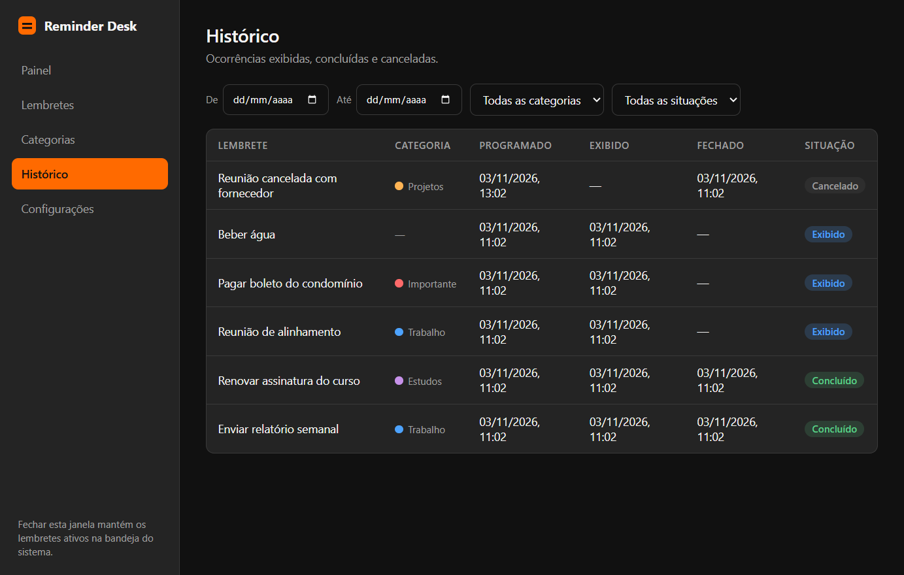
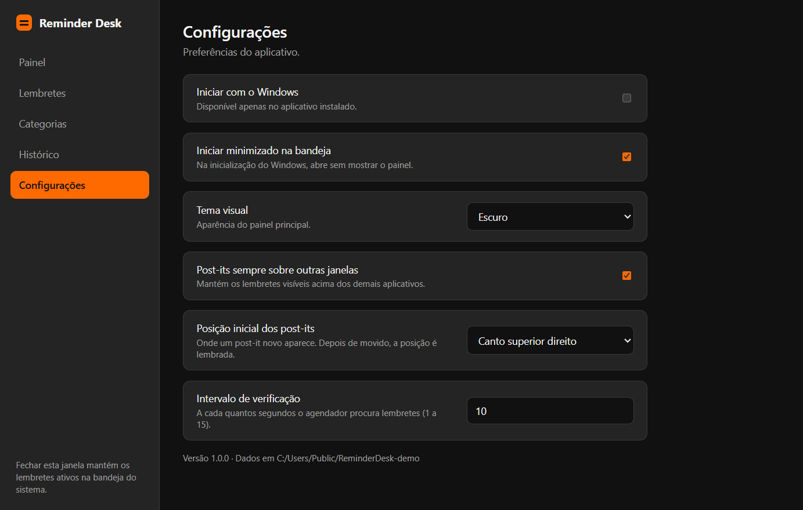

# Reminder Desk

Aplicativo desktop para Windows que exibe **lembretes como post-its flutuantes**, no dia e horário programados, mesmo com o painel principal fechado.

> Princípio central: o lembrete deve chegar até o usuário, e não depender de o usuário abrir a aplicação para consultá-lo.

## Download

Baixe a versão mais recente na página de [Releases](https://github.com/Thierry-BR39/aplicacao-lembrete/releases/latest):

| Arquivo | Para quê |
|---|---|
| `Reminder-Desk-Setup-1.0.0.exe` | Instalador. Recomendado para uso fixo: permite iniciar com o Windows. |
| `Reminder-Desk-1.0.0-portable.exe` | Executável único, sem instalação. Basta abrir. |

> Os executáveis não são assinados digitalmente. O Windows SmartScreen pode avisar na primeira execução: clique em **Mais informações → Executar assim mesmo**.

## Capturas de tela

### Post-its flutuantes

Cada lembrete abre como uma janela independente, sempre sobre as demais, que só some quando você a conclui. Podem aparecer vários ao mesmo tempo, cada um com a cor da categoria ou uma cor própria.

<p>
  
  
  
</p>

### Painel



### Lembretes



### Novo lembrete



### Categorias



### Histórico



### Configurações



## Stack

| Item | Escolha |
|---|---|
| Plataforma | Electron 45 (Node 24) |
| Linguagem | JavaScript (CommonJS) |
| Banco de dados | SQLite local via `node:sqlite` (embutido, sem módulo nativo) |
| Interface | HTML/CSS/JS sem framework, `contextIsolation` + `sandbox` |
| Testes | `node:test` (sem dependências) |
| Instalador | electron-builder (NSIS) |

> A especificação original previa C#/.NET/WPF. Como o computador de desenvolvimento só tinha Node.js, a implementação foi feita em Electron mantendo a arquitetura em camadas, as regras de negócio (RN001–RN010) e o esquema do banco. Ver [docs/adr/0001-electron-em-vez-de-wpf.md](docs/adr/0001-electron-em-vez-de-wpf.md).

## Como executar

```bash
npm install
npm start          # abre o painel; o ícone fica na bandeja
npm test           # 63 testes automatizados
npm run icons      # regenera assets/icon.png, icon.ico e tray.png
npm run dist       # gera o instalador em dist/ (electron-builder)
npm run portable   # gera o executável único e portátil em dist/
```

Os dados ficam em `%APPDATA%\ReminderDesk` (`reminderdesk.db`, `logs/`, `backups/`). Defina `REMINDERDESK_DATA_DIR` para usar outra pasta (útil em testes).

## Arquitetura

```
src/
  domain/            regras puras, sem I/O
    enums.js, errors.js
    rules/           recurrence.js, validation.js, windowBounds.js
  application/       casos de uso e serviços
    reminderService, categoryService, occurrenceService,
    settingsService, dashboardService, eventBus, compositionRoot
  infrastructure/
    persistence/     database.js (transações, migrações, backup), migrations.js, repositórios
    scheduling/      reminderSchedulerService.js
    windows/         trayIconService.js, startupService.js
    logging/         logger.js
  app/               processo principal e interface (Presentation)
    main.js, windowManager.js, ipc.js, preload.js
    renderer/panel/  painel principal
    renderer/postit/ janela do post-it
tests/               domain, application, infrastructure
```

Dependências apontam para dentro: `app → application → domain`; `infrastructure` implementa o acesso a dados e ao Windows.

## Como o agendador garante os requisitos

- **Processo principal, independente do painel.** Fechar o painel só descarta a janela; o processo continua na bandeja. Só **Sair** (menu da bandeja) encerra.
- **Uma ocorrência em aberto por lembrete.** Um índice único parcial no SQLite (`ux_occurrences_one_open`) impede duas ocorrências `Pending`/`Displayed` do mesmo lembrete (RN007, RN010).
- **Sem duplicidade.** A transição `Pending → Displayed` é um `UPDATE ... WHERE status = 'Pending'` dentro de transação; só quem altera a linha abre o post-it. O gerenciador de janelas também ignora ocorrências já abertas.
- **Recuperação (RN005).** A primeira passada ao iniciar abre as ocorrências vencidas (marcadas `IsOverdue`) e reapresenta as que estavam `Displayed` mas nunca foram fechadas.
- **Recorrência atrasada (RN010).** Ao fechar, a próxima ocorrência é a primeira estritamente futura calculada a partir da âncora original, sem abrir uma fila de post-its antigos. Meses curtos usam o último dia válido (RN006).
- **Falhas isoladas.** Cada passada captura e registra exceções; se abrir uma janela falhar, a ocorrência segue `Displayed` e é tentada de novo na passada seguinte.
- **Suspensão/relógio.** `powerMonitor` (`resume`, `unlock-screen`) força verificação imediata; como a consulta usa o horário atual, mudanças no relógio do Windows se resolvem sozinhas.
- **Fechamento = concluir.** Botão ✕, "Concluir" ou Alt+F4 concluem a ocorrência. Encerrar o aplicativo ou o Windows **não** conclui: o post-it volta na próxima execução.

## Janelas dos post-its

Janelas independentes, sem moldura, sempre no topo (`screen-saver` level), fora da barra de tarefas, arrastáveis pelo cabeçalho e redimensionáveis. São abertas com `showInactive`, para não roubar o foco do que o usuário está digitando. Posição e tamanho são salvos por lembrete e validados contra os monitores atuais ao reabrir (`domain/rules/windowBounds.js`).

## Integração com o Windows

- **Bandeja:** ícone com menu (Abrir, Novo lembrete, Consultar, Configurações, Sair).
- **Inicialização automática:** `app.setLoginItemSettings` grava em `HKCU\Software\Microsoft\Windows\CurrentVersion\Run` com `--hidden`. Só é aplicada no aplicativo instalado (em desenvolvimento apontaria para o `electron.exe`).
- **Iniciar minimizado:** iniciado pelo Windows com `--hidden` e a opção ligada, o painel não abre. Uma execução manual sempre mostra o painel.
- **Instância única:** uma segunda execução apenas pede à principal que abra o painel.

## Banco de dados

Tabelas `reminders`, `categories`, `reminder_occurrences`, `app_settings` e `reminder_window_settings`, com chaves estrangeiras, `CHECK`s e índices. Migrações versionadas em `PRAGMA user_version`; antes de aplicar migrações em um banco existente é criado um backup (`VACUUM INTO`) em `backups/`. Exclusão de lembretes é lógica (`deleted_at`), preservando o histórico (RN009). Categorias em uso são desativadas em vez de apagadas.

## Testes

`npm test` cobre recorrência, validação, posicionamento de janelas, serviços, agendador (disparo no horário, duplicidade, múltiplos no mesmo horário, recorrências diária/semanal/mensal, recuperação de atrasados, reinício com post-it aberto, mudança de relógio, suspensão, falha ao abrir janela) e banco (migrações, backup, rollback, restrições).

O que os testes automatizados **não** cobrem e deve ser verificado manualmente no Windows instalado: exibição sobre outros aplicativos em tela cheia, comportamento com vários monitores reais, inicialização pelo Windows e o instalador.

## Verificação visual

Com `REMINDERDESK_CAPTURE_DIR=<pasta>` definido, o aplicativo percorre as telas, salva PNGs e encerra (`src/app/devCapture.js`). Não é usado em execução normal.
